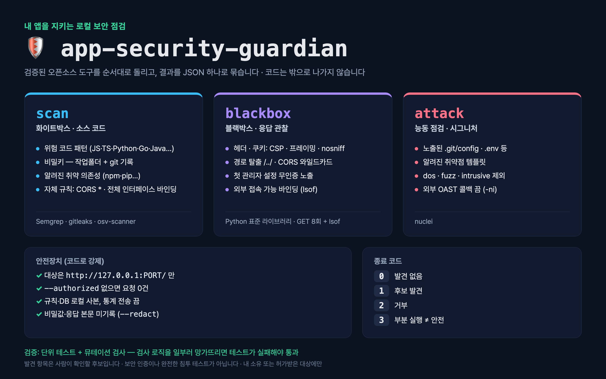

# app-security-guardian (가디언)

[English](README.md) · **한국어**

**내가 소유한 웹앱**을 **로컬에서만** 점검하는 방어용 보안 점검 도구입니다.
규칙을 새로 만들지 않고, 검증된 오픈소스 스캐너를 순서대로 실행해 결과를 JSON 하나로 묶습니다. 점검 대상 코드는 밖으로 나가지 않습니다.



## 왜 만들었나

작은 팀·1인 개발자는 보안 점검 없이 웹앱을 배포하기 쉽습니다. 상용 스캐너는 비싸고, 대상을 스스로 공격하는 "AI 침투 테스트 에이전트"는 돌리기 위험하고 법적 부담이 큽니다. 가디언은 그 사이를 노립니다 — 관점별 명령 하나, 코드로 강제된 안전 기본값, 사람이 검토할 수 있는 결과.

## 모드

| 모드 | 점검 내용 | 엔진 |
|---|---|---|
| `scan` (화이트박스) | 기본 규칙팩 기준 20개+ 언어의 위험 코드 패턴(JS/TS·Python·Java·Go·Ruby·PHP·Terraform…), 작업폴더 **및 git 기록**의 비밀키, 알려진 취약 의존성, 내장 Python AST 검사 | Semgrep, gitleaks, osv-scanner |
| `blackbox` | 보안 헤더(CSP·프레이밍·nosniff), 쿠키 플래그, 경로 탈출(`/../`), CORS 와일드카드 | Python 표준 라이브러리 (GET 4회) |
| `attack` | 알려진 시그니처 능동 점검: 노출된 `.git/config`·`.env`, 알려진 취약점 템플릿 | nuclei (OAST 끔, dos·fuzz·intrusive 제외) |

## 안전장치 (문서가 아니라 코드로 강제)

- 대상은 **`http://127.0.0.1:PORT/`** 만 — 원격 호스트·https·`localhost` 별칭은 거부(exit 2)
- 모든 모드는 `--authorized` 필수. 없으면 파일 읽기 **0건**, 요청 **0건**
- Semgrep은 `--metrics=off` + **로컬 규칙 파일만**, osv-scanner는 오프라인 DB, nuclei는 `-ni`(외부 상호작용 서버 미사용)
- 비밀키 값·소스 원문·응답 본문은 보고서에 남기지 않음 (gitleaks `--redact`)
- 도구 하나라도 없거나 실패하면 **exit 3(PARTIAL)** — 절대 "깨끗함"으로 보고하지 않음

## 에이전트 스킬로 쓰기

레포 루트가 그대로 스킬입니다(`SKILL.md`, 표준 `name`·`description` 머리말). 에이전트의 스킬 폴더에 clone한 뒤 *"./my-app 보안 점검해줘"* 처럼 말하면 됩니다.

| 에이전트 | 설치 |
|---|---|
| Claude Code | `git clone https://github.com/kims6305-bjk/app-security-guardian ~/.claude/skills/app-security-guardian` |
| Codex CLI | `git clone https://github.com/kims6305-bjk/app-security-guardian ~/.codex/skills/app-security-guardian` |
| Hermes Agent | `git clone https://github.com/kims6305-bjk/app-security-guardian ~/.hermes/skills/security/app-security-guardian` |
| OpenClaw | `git clone https://github.com/kims6305-bjk/app-security-guardian <workspace>/skills/app-security-guardian` |

그다음 그 폴더에서 [설치](#설치)의 1회 준비를 실행하세요. 스킬은 에이전트에게 점검 전 소유 확인, 127.0.0.1 한정, 비밀값 출력 금지를 지시합니다.

## 설치

```bash
brew install semgrep gitleaks osv-scanner nuclei   # macOS. 리눅스는 각 도구 공식 설치법
nuclei -update-templates                           # 템플릿 1회 다운로드
python3 fetch_rules.py                             # Semgrep 레지스트리 규칙을 rules/ 에 1회 다운로드
```

가디언 자체는 Python 3.9+ 표준 라이브러리만 씁니다 — `pip install` 불필요.

## 사용법

```bash
python3 guardian.py scan ./my-app --authorized

# 먼저 앱을 로컬에서 띄운 뒤
python3 guardian.py blackbox http://127.0.0.1:3000/ --authorized
python3 guardian.py attack   http://127.0.0.1:3000/ --authorized   # 전체 템플릿은 몇 분 걸림
```

| 종료 코드 | 의미 |
|---|---|
| `0` | 발견 없음 (모든 도구 실행됨) |
| `1` | 후보 발견 — 확인 필요 |
| `2` | 거부 (`--authorized` 없음 또는 루프백 아닌 대상) |
| `3` | 부분 실행 — 도구 누락·실패. 안전하다는 뜻이 **아님** |

## 어떻게 검증하나

```bash
python3 reports/run_tests.py
```

- **단위 테스트**: `fixtures/vuln-js`(일부러 취약하게 만든 샘플, 안의 키는 가짜)는 모든 도구가 잡아야 하고, `fixtures/safe-js`는 high 0건이어야 합니다. blackbox·attack 테스트는 127.0.0.1의 일회용 서버로 돌립니다.
- **뮤테이션 검사**: 검사 로직을 일부러 망가뜨린 사본(경로 탈출 탐지 제거, Semgrep 오류를 깨끗함으로 보고, `--redact` 끄기 등)에서 테스트가 **실패해야** 통과입니다. 망가진 코드에서도 통과하는 테스트는 아무것도 증명하지 못하니까요.
- 현재 게이트: 테스트 32개 통과, 뮤턴트 23/23 검출.

## 에이전트가 적용하는 보강 (사용자 승인 후)

스킬로 쓰면 에이전트가 발견 항목을 수정안으로 바꿔 적용합니다. 보안 헤더(CSP, `X-Frame-Options: DENY`, `nosniff`), 정적 파일 제공을 public 폴더로 제한, CORS 와일드카드 제거, 취약 패키지 업그레이드, 유출 키 재발급을 다룹니다. 요청하면 **모든 크롤러 접근을 거부하는 `robots.txt`**(`User-agent: *` / `Disallow: /`)도 설정합니다. 단, robots.txt는 규칙을 지키는 봇만 따릅니다. 접근 차단 수단이 아니고, 검색엔진 노출도 함께 사라집니다. 수정 후에는 같은 모드로 다시 점검합니다.

## 한계

- 발견 항목은 **사람이 확인할 후보**입니다. 보안 인증도, 완전한 침투 테스트도 아닙니다.
- `attack`은 시그니처 기반이라 비즈니스 로직 결함·인증 우회·새로운 유형의 취약점은 찾지 못합니다.
- 데이터 흐름(taint) 추적은 공개 Semgrep 규칙이 제공하는 범위까지만 됩니다.
- 내 소유이거나 명시적으로 허가받은 대상에만 사용하세요.

## 라이선스

이 레포는 MIT. 호출하는 스캐너는 각자의 라이선스를 따릅니다 (Semgrep LGPL-2.1, gitleaks MIT, osv-scanner Apache-2.0, nuclei MIT). Semgrep 레지스트리 규칙은 **재배포하지 않으며** `fetch_rules.py`가 받아옵니다.
