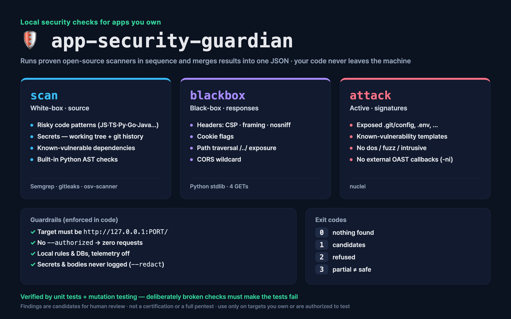

# app-security-guardian

**English** · [한국어](README.ko.md)

A defensive, **local-only** security checker for web apps **you own**.
It doesn't reinvent rules: it runs proven open-source scanners in sequence and merges everything into one JSON report. Your source code never leaves the machine.



## Why

Small teams and solo builders ship web apps without a security review. Commercial scanners are expensive, and "AI pentest agents" that autonomously attack targets are risky to run and legally heavy. Guardian sits in between: one command per angle, safe defaults enforced in code, and results a human can review.

## Modes

| Mode | What it checks | Engine |
|---|---|---|
| `scan` (white-box) | Risky code patterns in 20+ languages with the default rule packs (JS/TS, Python, Java, Go, Ruby, PHP, Terraform…), secrets in the working tree **and git history**, known-vulnerable dependencies, built-in Python AST checks | Semgrep, gitleaks, osv-scanner |
| `blackbox` | Security headers (CSP, framing, nosniff), cookie flags, path traversal (`/../`), CORS wildcard | Python stdlib (4 GETs) |
| `attack` | Active known-signature probes: exposed `.git/config`, `.env`, known-vulnerability templates | nuclei (no OAST, no dos/fuzz/intrusive) |

## Guardrails (enforced in code, not just documented)

- Targets must be **`http://127.0.0.1:PORT/`** — remote hosts, https and `localhost` aliases are refused (exit 2)
- Every mode requires `--authorized`; without it **zero** files are read and **zero** requests are sent
- Semgrep runs with `--metrics=off` on **local rule files only**; osv-scanner uses an offline DB; nuclei runs with `-ni` (no external interaction server)
- Secret values, source snippets and response bodies are never written to reports (gitleaks `--redact`)
- If any tool is missing or fails, the result is **exit 3 (PARTIAL)** — never reported as "clean"

## Use it as an agent skill

The repo root is a ready-made skill (`SKILL.md`, standard `name` + `description` frontmatter). Clone it into your agent's skills folder and just ask, e.g. *"security-check my app in ./my-app"*:

| Agent | Install |
|---|---|
| Claude Code | `git clone https://github.com/kims6305-bjk/app-security-guardian ~/.claude/skills/app-security-guardian` |
| Codex CLI | `git clone https://github.com/kims6305-bjk/app-security-guardian ~/.codex/skills/app-security-guardian` |
| Hermes Agent | `git clone https://github.com/kims6305-bjk/app-security-guardian ~/.hermes/skills/security/app-security-guardian` |
| OpenClaw | `git clone https://github.com/kims6305-bjk/app-security-guardian <workspace>/skills/app-security-guardian` |

Then run the one-time setup from [Install](#install) inside that folder. The skill tells the agent to confirm ownership before testing, stay on 127.0.0.1, and never print secret values.

## Install

```bash
brew install semgrep gitleaks osv-scanner nuclei   # macOS; on Linux use each tool's official installer
nuclei -update-templates                           # one-time template download
python3 fetch_rules.py                             # one-time download of Semgrep registry rules into rules/
```

Guardian itself is Python 3.9+ standard library only — no `pip install`.

## Usage

```bash
python3 guardian.py scan ./my-app --authorized

# start your app locally first, then:
python3 guardian.py blackbox http://127.0.0.1:3000/ --authorized
python3 guardian.py attack   http://127.0.0.1:3000/ --authorized   # full template set takes a few minutes
```

| Exit code | Meaning |
|---|---|
| `0` | nothing found (all tools ran) |
| `1` | candidates found — review them |
| `2` | refused (no `--authorized`, or a non-loopback target) |
| `3` | partial run — a tool was missing or failed. **Not** safe |

## How it is verified

```bash
python3 reports/run_tests.py
```

- **Unit tests** against synthetic fixtures: `fixtures/vuln-js` (intentionally vulnerable; the key in it is fake) must be flagged by every tool, and `fixtures/safe-js` must produce zero high-severity findings. Blackbox/attack tests run against throwaway servers on 127.0.0.1.
- **Mutation testing**: the gate deliberately breaks the checks (e.g. drops traversal detection, reports a crashed Semgrep as clean, turns off `--redact`) and requires the tests to **fail** each time. A test suite that passes on broken code proves nothing.
- Current gate: 32 tests pass, 23/23 mutants killed.

## Hardening the agent applies (with your go-ahead)

When used as a skill, the agent turns findings into fixes: security headers (CSP, `X-Frame-Options: DENY`, `nosniff`), confining static file serving to the public dir, dropping a wildcard CORS, upgrading flagged packages, rotating leaked keys, and, on request, a **`robots.txt` that asks all crawlers to stay out** (`User-agent: *` / `Disallow: /`). Note: robots.txt is honored only by well-behaved bots. It is not access control, and it also hides the site from search engines. Each fix is re-checked with the same mode.

## Limitations

- Findings are **candidates for a human to confirm** — not a certification and not a full penetration test.
- `attack` is signature-based: it will not find business-logic flaws, auth bypasses or novel bug classes.
- Data-flow (taint) coverage is whatever the public Semgrep rules provide.
- Use only on targets you own or are explicitly authorized to test.

## License

MIT for this repository. The scanners it calls keep their own licenses (Semgrep LGPL-2.1, gitleaks MIT, osv-scanner Apache-2.0, nuclei MIT). Semgrep registry rules are **not redistributed** — `fetch_rules.py` downloads them for you.
